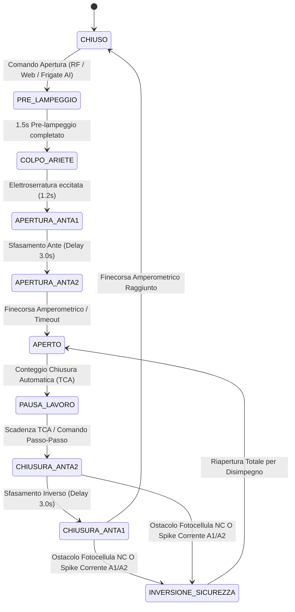

# SmartGate Dual-MCU — Deep Technical Architecture & Specifications
### *Automazione Elettromeccanica per Cancelli a Due Ante Battenti (Arduino Nano + ESP32)*

---

## 1. Topologia Hardware & Separazione dei Domini

Il sistema adotta un'architettura **Dual-MCU disaccoppiata** per garantire che le funzioni di sicurezza fisica non siano mai subordinate allo stato dello stack di rete Wi-Fi:

```
    ┌────────────────────────────────────────────────────────┐
    │                      ESP32 (3.3V)                      │
    │   • Web Server Dark Mode Glassmorphism (WebSockets)    │
    │   • Broker MQTT & Integrazione Telecamere Frigate AI   │
    │   • Relè Ausiliari (Garage, Cancelletto Pedonale)      │
    └───────────────────────────▲────────────────────────────┘
                                │ Level Shifter LLC (3.3V ◄► 5.0V)
                                │ SoftwareSerial Bidirezionale (19200 baud)
    ┌───────────────────────────▼────────────────────────────┐
    │                   ARDUINO NANO (5.0V)                  │
    │   • Hard Real-Time Motor Control Loop (Zero Lag)       │
    │   • 2x Driver Ponte H BTS7960 (PWM Soft Start/Stop)    │
    │   • Current Sensing ADC (A1/A2): Anticalpestio < 2ms   │
    │   • Fotocellule Fisiche NC & Relè Eco-Mode             │
    │   • Ricevitore Radio RF Hardware                       │
    └────────────────────────────────────────────────────────┘
```

---

## 2. Specifiche Elettriche & Mappa dei Pin

### 2.1 Arduino Nano (Controllo Motori & Sicurezza - 5V Logic)
* **Driver BTS7960 Motore 1 (Anta 1):**
  * `PIN_M1_OPEN = D3` (RPWM - Apertura)
  * `PIN_M1_CLOSE = D5` (LPWM - Chiusura)
  * `PIN_M1_CURRENT = A1` (R_IS / L_IS uniti con resistenza shunt verso GND per Current Sensing)
* **Driver BTS7960 Motore 2 (Anta 2):**
  * `PIN_M2_OPEN = D6` (RPWM - Apertura)
  * `PIN_M2_CLOSE = D9` (LPWM - Chiusura)
  * `PIN_M2_CURRENT = A2` (R_IS / L_IS Current Sensing)
* **Modulo Relè Elegoo (Uscite Attive Basse):**
  * `PIN_RELAY_FLASH = D10` (Relè 1: Lampeggiante 24V)
  * `PIN_RELAY_LOCK = D4` (Relè 2: Elettroserratura 12V/24V)
  * `PIN_RELAY_ECO = A4` (Relè 6: Eco-Mode Fotocellule)
* **Ingressi di Sicurezza:**
  * `PIN_PHOTO = D8` (Contatto NC Fotocellula RX: HIGH = Ostacolo, LOW = Libero)
  * `PIN_RADIO_CH1 = D2` (Telecomando RF 433 MHz Passo-Passo)
* **Comunicazione Inter-MCU:**
  * `PIN_ESP_RX = D12` (Connesso a TX ESP32 tramite Logic Level Converter)
  * `PIN_ESP_TX = D11` (Connesso a RX ESP32 tramite Logic Level Converter)

---

## 3. Macchina a Stati Finita (FSM) del Cancello



---

## 4. Algoritmo di Anticalpestio & Current Sensing

Durante il movimento, l'Arduino Nano campiona continuamente i pin `A1` e `A2`:
* **Filtro passa-basso digitale:** Elimina i transitori di spunto iniziale (inrush current) mascherando i primi 800 ms di avvio con rampa PWM dolce (*Soft Start*).
* **Soglia di Scatto:** Se la corrente misurata supera la soglia di sforzo per più di 3 campionamenti consecutivi ($> 50\text{ ms}$), il loop disabilita istantaneamente le uscite PWM e inverte la marcia (*Safety Reversal*).

---

## 5. Protocollo Seriale Inter-MCU (Frame ASCII/Binario)

La comunicazione tra Arduino Nano ed ESP32 avviene a 19200 baud con frame a pacchetto validati da checksum:

```text
Struttura Pacchetto:
[START_BYTE: 0x02] [OPCODE: 1 Byte] [PAYLOAD_LEN: 1 Byte] [DATA: N Bytes] [CRC8: 1 Byte] [STOP_BYTE: 0x03]
```

### Tabella Opcodes:
| Opcode | Direzione | Significato | Payload |
| :--- | :--- | :--- | :--- |
| `0x10` | ESP32 $\rightarrow$ Nano | Comando Passo-Passo (Toggle) | Vuoto |
| `0x11` | ESP32 $\rightarrow$ Nano | Comando Pedonale (Solo Anta 1) | Vuoto |
| `0x12` | ESP32 $\rightarrow$ Nano | Arresto di Emergenza (E-Stop) | Vuoto |
| `0x20` | Nano $\rightarrow$ ESP32 | Telemetria Live | Stato (1B), Corrente M1 (2B), Corrente M2 (2B), Angolo M1 (1B), Angolo M2 (1B) |
| `0x30` | Nano $\rightarrow$ ESP32 | Evento Sicurezza / Allarme | Codice Allarme (1B: Fotocellula, Sovracorrente, Timeout) |

---

## 6. Integrazione Smart Home & Visione Artificiale Frigate AI

L'ESP32 interfaccia il cancello con l'ecosistema Home Assistant:
1. **Riconoscimento Veicoli via Frigate AI:** Una telecamera di videosorveglianza esterna elabora il feed video. Quando un veicolo autorizzato entra nella zona di rilevamento (*Plate Recognition* o *Car Object Detection*), invia un messaggio MQTT su `gate/command/open`.
2. **Web UI Glassmorphism:** Dashboard locale in dark mode servita direttamente dall'ESP32 con feedback real-time su correnti, stato ante e comandi rapidi.
