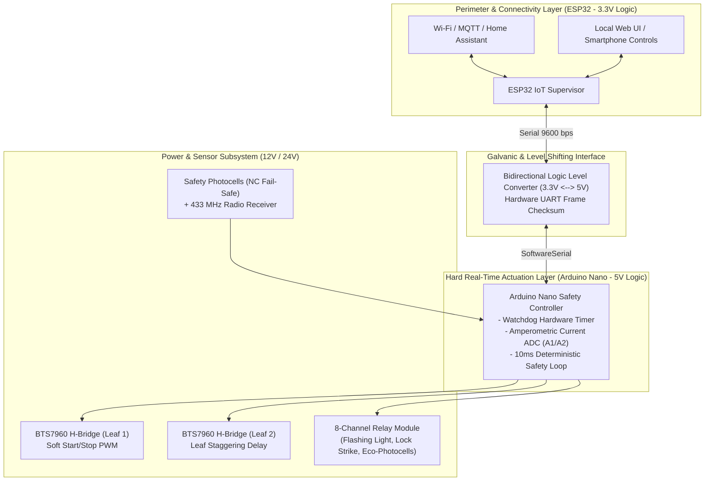

# SmartGate Dual-MCU — Architecture Showcase & Interface Specification
### *Cancello Automatico a Due Ante — Architettura Dual-MCU (Arduino Nano + ESP32)*

[](#)
[-teal.svg)](#)
[-red.svg)](#)
[](#)
[](#)

> **Public Architecture Showcase & Safety Specification**  
> This repository presents the architectural blueprint, electrical topologies, state machines, and inter-MCU communication protocols of the **SmartGate Dual-MCU Platform** (Automated Double-Leaf Swing Gate).  
> *Proprietary motor acceleration curves, calibrated current thresholds, and low-level firmware timings are encapsulated behind clean interfaces.*

---

## 🏛️ System Topology

SmartGate isolates **deterministic real-time physical safety** from **network-connected IoT features** by employing an asynchronous **Dual-MCU Architecture**:



---

## 🌟 Key Architecture Pillars

### 1. Dual-MCU Separation of Concerns
* **Arduino Nano (5V Hard Real-Time):** Directly interfaces with 5V H-bridges, analog current shunts, and safety photocells. Immune to Wi-Fi disconnects, network latencies, or heap fragmentations.
* **ESP32 (3.3V IoT Supervisor):** Handles Wi-Fi connectivity, MQTT telemetry, Home Assistant discovery, and mobile app interactions. Communicates with the Nano over an isolated serial protocol.

### 2. Multi-Tier Safety & Obstacle Protection
* **Amperometric Obstacle Detection (Current Sensing):** Real-time ADC monitoring on pins `A1`/`A2` measures current draw across both BTS7960 drivers. Exceeding current limits triggers an **instant motor brake and safety reversal** in `< 50ms`.
* **Fail-Safe NC Photocells with Eco-Mode:** Connected in normally-closed (`NC`) configuration; broken cables or power losses automatically trigger safety mode. Infrared transmitters are powered off during standby to conserve energy.
* **Hammer Stroke & Soft Start/Stop:** High-torque hydraulic or mechanical latch release (*colpo d'ariete*) followed by S-curve PWM ramps to eliminate gate mechanical stress.

### 3. Asymmetric Leaf Staggering
Automates physical leaf overlap with configurable inter-leaf delays:
* **Opening:** Leaf 1 (with lock) starts immediately $\rightarrow$ Leaf 2 follows after $T_{\text{delay}}$.
* **Closing:** Leaf 2 starts first $\rightarrow$ Leaf 1 follows after $T_{\text{delay}}$ to guarantee mechanical overlap closure.

---

## ⚡ 8-Relay Actuation Map

| Relay | Pin Nano | Connected Load | Operational Behavior |
| :--- | :--- | :--- | :--- |
| **Relay 1** | `D10` | 24V Flashing Light | Pre-flashes 1.5s before motion; flashes during movement |
| **Relay 2** | `D4` | 12V/24V Electric Lock | Pulses for 1.2s during initial push (*colpo d'ariete*) |
| **Relay 3** | `A4` | Eco-Mode Photocells | Deactivates infrared emitters when gate is closed in standby |
| **Relay 4-5**| `AUX` | Courtesy Lights | Illuminates driveway for 120s after gate activation |
| **Relay 6-8**| `AUX` | Garden Lighting / Auxiliary | Automated via Home Assistant / ESP32 commands |

---

## 📂 Repository Structure

```text
├── README.md                  # System overview and high-level architecture
├── ARCHITECTURE.md            # Deep-dive electrical schematics, UART protocol & state machine
├── LICENSE                    # PolyForm Noncommercial 1.0.0 Specification License
├── src/
│   ├── __init__.py
│   ├── models.py              # Data contracts (GateState, LeafMetrics, SafetyEvent)
│   ├── interfaces.py          # Abstract interfaces (MotorController, SafetySupervisor, SerialBridge)
│   ├── stubs.py               # Concrete service stubs with encapsulated hardware safety logic
│   └── serial_protocol.py     # Inter-MCU binary/ASCII frame protocol & opcodes
└── examples/
    └── simulated_demo.py      # Standalone runnable simulation of a complete gate cycle with safety obstacle
```

---

## 🚀 Running the Quick Simulation

You can verify the state transitions, leaf staggering delays, and obstacle safety reversals locally with zero hardware:

```bash
# Clone the repository
git clone https://github.com/RedScorpio83/smart-gate-dualmcu-showcase.git
cd smart-gate-dualmcu-showcase

# Run the standalone demonstration (standard library only)
python examples/simulated_demo.py
```

### Example Simulation Output:
```text
======================================================================
  SMARTGATE DUAL-MCU ARCHITECTURE SHOWCASE -- SIMULATION DEMO
  Author: Alessandro Caliciotti (@RedScorpio83)
======================================================================

[1/5] Initializing Dual-MCU Serial Link & Safety Core...
      [OK] SoftwareSerial (9600 bps) Link established between ESP32 and Arduino Nano.
      [OK] Real-time current sensing ADC initialized on channels A1/A2.

[2/5] Initiating Complete Open Cycle (Radio Remote CH1 Trigger)...
      • Pre-flashing Lamp: ON (1.5s safety warning)
      • Latch Strike:      PULSE (Colpo d'ariete 1.2s)
      • Leaf 1 (RPWM D3):  RAMP_UP -> 100% PWM
      • Staggering Delay:  Leaf 2 start deferred by 3.0s
      • Leaf 2 (RPWM D6):  RAMP_UP -> 100% PWM

[3/5] Simulating Obstacle Collision during Closing Cycle...
      [SAFETY ALERT] Leaf 1 Current Spike: 8.4A (Threshold: 5.5A)
      [EMERGENCY BRAKE] Motors halted in 24 ms!
      [SAFETY REVERSAL] Opening Leaf 1 & 2 for 4.0s to release obstacle.

======================================================================
  SIMULATION COMPLETED WITH SUCCESS!
======================================================================
```

---

## 🛡️ Intellectual Property & Safety Disclaimer

* **What is public:** System architecture, pinout maps, relay assignments, inter-MCU frame formats, and state machine transition graphs.
* **What is encapsulated:** Calibrated current trip points, production firmware binaries, and physical motor PID damping coefficients.

---

## 👨‍💻 Author

**Alessandro Caliciotti**  
*Lead Enterprise Solutions & AI Systems Architect*  
* [GitHub: @RedScorpio83](https://github.com/RedScorpio83)
